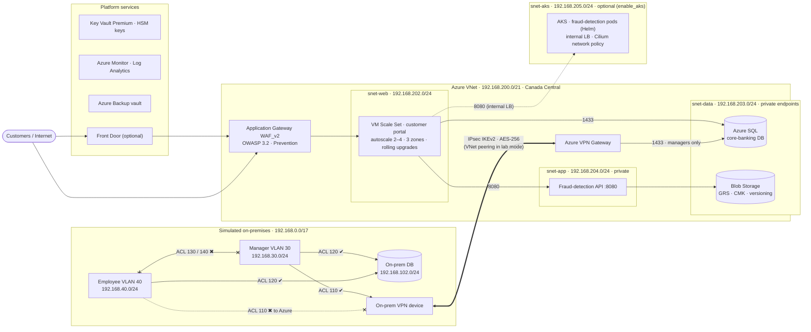

# Hybrid Cloud Migration and CI/CD Automation on Azure

*Secure hybrid architecture for N-Financial Bank: Terraform · GitHub Actions (OIDC) · AKS + Helm · Azure Policy · WAF · private endpoints · SLOs & burn-rate alerts · FinOps*

[](https://github.com/SANJU-571/hybrid-cloud-migration-cicd-azure/actions/workflows/ci.yml)
[](https://github.com/SANJU-571/hybrid-cloud-migration-cicd-azure/actions/workflows/app.yml)


A deployable, production-patterned **hybrid cloud for a retail bank**, built entirely as code.
It started as my capstone for the Post Graduate Diploma in Modern Networks and Cloud Computing at Lambton College, *Secure & Scalable Hybrid Cloud Network for N-Financial Bank*: the bank's on-premises network was first modelled in Cisco Packet Tracer, then migrated to a hybrid design on **Microsoft Azure**, implemented end-to-end with **Terraform**, **GitHub Actions (OIDC)** and **automated security and network tests**. Since then I have extended it with a containerised fraud-detection service on **AKS** (Docker, Helm), **Azure Policy** guardrails, **SLO-based alerting** and **FinOps** reporting.

> One command builds a simulated on-premises data centre, an Azure landing zone, the encrypted link between them, a load-balanced web tier behind a WAF, a private application tier, private-endpoint databases, centralised logging, backups and budgets. Another command removes all of it.

---

## Architecture



More detail: [docs/ARCHITECTURE.md](docs/ARCHITECTURE.md), including the address plan, traffic flows and the NSG rule matrix that replaces the Cisco ACLs.

## What this project demonstrates

| Area | Implementation |
|---|---|
| **Infrastructure as Code** | 11 reusable Terraform modules, remote state in Azure Storage (Entra ID auth, versioned), environment profiles |
| **Containers & Kubernetes** | Fraud-detection API in Python, distroless non-root image, Helm chart (HPA, PDB, NetworkPolicy, probes, zone spread); optional AKS (Entra ID + Azure RBAC, workload identity, Cilium, Container Insights) |
| **Governance (policy-as-code)** | Custom Azure Policy definitions in JSON: required cost/ownership tags, no public IPs on NICs, no public SQL/Storage; Canada-only data residency; Gatekeeper rules on AKS (no privileged containers) |
| **Hybrid networking** | Route-based Site-to-Site VPN (IKEv2, AES-256/SHA-256, DH14, PFS2048) or VNet peering; private DNS resolved from both sides |
| **Network security** | Tiered subnets, NSGs that enforce the original Cisco ACLs (110/120/130/140), WAF_v2 in Prevention mode, no public IPs on servers, NAT-only egress |
| **High availability** | Zone-redundant VM Scale Set with CPU autoscale, Application Health extension, automatic instance repair, rolling upgrades |
| **Data protection** | Azure SQL and Blob Storage behind private endpoints, HSM-backed customer-managed keys with auto-rotation, blob versioning, lifecycle tiering, GRS |
| **Identity & secrets** | Managed identities, Azure RBAC, Key Vault in RBAC mode with purge protection; SSH keys and DB passwords generated and stored only in Key Vault |
| **Observability & audit** | Log Analytics, subscription Activity Log export, Key Vault/SQL/WAF/Blob audit logs, metric alerts, an alert on any NSG rule change |
| **Resilience** | Azure Backup daily policy (7 daily / 4 weekly / 12 monthly), optional geo-redundant vault with cross-region restore |
| **SRE** | SLOs + error-budget policy, multi-window burn-rate alerts with `promtool` unit tests, Grafana dashboard, runbooks, postmortem template, game-day fault injection ([docs/SRE.md](docs/SRE.md)) |
| **FinOps** | Cost-profile switches, Log Analytics daily cap, monthly budget with 50/80/100% alerts, `cost_center` tag enforced by policy, cost report (forecast vs budget, cost by service/tag, waste checks), one-command teardown |
| **DevSecOps** | GitHub Actions CI (fmt, validate, TFLint, Checkov, ShellCheck), Trivy image scan, Checkov on rendered Kubernetes manifests, SBOM + provenance on published images, OIDC deploy with no stored secrets, manual approval gate for apply/destroy |
| **Testing** | Unit tests (pytest); every change deploys the Helm chart to a throwaway kind cluster and runs smoke tests, `helm test` and a zero-downtime rolling-update check; `validate-deployment.sh` checks the WAF path, load balancing and east-west traffic, then proves each ACL from real VMs using `az vm run-command` |

## Azure services used

| Capability | Azure service | Terraform module |
|---|---|---|
| Network isolation | Virtual Network, subnets, Network Security Groups, NAT Gateway | `network` |
| Hybrid connectivity | VPN Gateway (VpnGw1AZ) + Local Network Gateways, or VNet peering; ExpressRoute-ready | `connectivity` |
| Compute & autoscaling | Linux Virtual Machine Scale Set + Azure Autoscale, Application Health extension | `compute` |
| Load balancing | Application Gateway WAF_v2 / Azure Load Balancer (Standard) | `compute` |
| Web protection | Azure Web Application Firewall policy (OWASP 3.2 + Bot Manager) | `compute` |
| Global edge & CDN | Azure Front Door Standard | `edge` |
| DNS | Azure DNS (public label) + Azure Private DNS zones | `compute`, `data` |
| Relational database | Azure SQL Database (private endpoint, Entra ID admin, auditing) | `data` |
| Object storage | Azure Blob Storage (versioning, lifecycle management, GRS, CMK) | `data` |
| Identity & access | Microsoft Entra ID, managed identities, Azure RBAC | `security` |
| Secrets & keys | Azure Key Vault Premium (secrets, HSM keys, automatic rotation) | `security` |
| DDoS protection | Azure DDoS Network Protection (toggle) | `network` |
| Threat protection | Microsoft Defender for Cloud (toggle) | `security` |
| Monitoring & audit | Azure Monitor, Log Analytics, Activity Log, metric & activity alerts | `monitoring` |
| Backup & DR | Azure Backup (Recovery Services vault, daily policy) | `backup` |
| Cost governance | Microsoft Cost Management budgets | `monitoring` |
| Kubernetes | Azure Kubernetes Service (Free tier, CNI Overlay + Cilium, autoscaler), internal Standard Load Balancer | `aks` |
| Container monitoring | Container Insights (managed identity, data collection rule), kube-audit logs | `aks` |
| Governance | Azure Policy (custom definitions + built-in Allowed locations), Azure Policy add-on for AKS | `governance`, `aks` |
| Container registry | GitHub Container Registry (image + Helm chart, free for public repos) | `.github/workflows/app.yml` |
| CI/CD | GitHub Actions + Terraform, OIDC to Entra ID, VMSS rolling upgrades, Helm atomic deploys | `.github/workflows` |
| On-prem simulation | Separate VNet with VLAN subnets and test VMs (mirrors the Packet Tracer lab) | `onprem` |

## Repository layout

```
.
├── infra/                      # Terraform root module
│   ├── main.tf                 # wires the modules together
│   ├── variables.tf            # feature flags & sizing
│   ├── environments/           # lab | lowcost | full profiles
│   └── modules/
│       ├── aks/                # AKS, Container Insights, Kubernetes policies (optional)
│       ├── governance/         # Azure Policy definitions (policies/*.json) and assignments
│       ├── network/            # VNet, subnets, NSGs (ACLs), NAT, DDoS
│       ├── onprem/             # simulated data centre + test VMs
│       ├── connectivity/       # IPsec S2S VPN or peering
│       ├── security/           # Key Vault, identities, CMK, Defender
│       ├── compute/            # WAF, VMSS, autoscale, fraud-detection VM
│       ├── data/               # Azure SQL, Blob, private endpoints & DNS
│       ├── monitoring/         # Log Analytics, alerts, Activity Log, budget
│       ├── backup/             # Recovery Services vault & policy
│       └── edge/               # Front Door
├── app/fraud-detection/        # Python API, Dockerfile (distroless), unit tests
├── deploy/helm/fraud-detection # Helm chart (+ values-aks.yaml)
├── observability/              # docker compose: Prometheus SLO rules + tests, Grafana dashboard
├── monitoring/queries/         # KQL: SLO, burn rate, latency, WAF, log cost, AKS restarts
├── finops/                     # cost report (Cost Management API) + tests
├── scripts/                    # bootstrap state, OIDC setup, validation tests, game day
├── .github/workflows/          # ci · app (container/K8s) · deploy (infra) · deploy-app (AKS) · finops
└── docs/                       # architecture, guide, security, SRE, runbooks, postmortem template, deck
```

## Quick start

Full walkthrough, from an empty Azure subscription to a validated deployment: **[docs/DEPLOYMENT_GUIDE.md](docs/DEPLOYMENT_GUIDE.md)**

```bash
az login
export TF_VAR_alert_email="you@example.com"
./scripts/bootstrap-tfstate.sh                     # once: remote state
make init plan apply PROFILE=lab
make validate PROFILE=lab                          # run the end-to-end tests
make destroy PROFILE=lab                           # stop the billing
```

## Run the app and the SRE lab locally (free)

```bash
cd observability && docker compose up -d --build   # API :8080 · Prometheus :9090 · Grafana :3000
curl -s -X POST localhost:8080/v1/score -d '{"amount": 12000, "country": "US", "card_present": false}'
FAULT_ERROR_RATE=0.2 docker compose up -d fraud-api # inject errors -> burn-rate alert fires
```

Kubernetes: `helm install fraud-detection deploy/helm/fraud-detection` on any cluster (kind, minikube, AKS). On AKS use the **Deploy app (AKS)** workflow. Details in [docs/SRE.md](docs/SRE.md) and [docs/DEPLOYMENT_GUIDE.md](docs/DEPLOYMENT_GUIDE.md#phase-10-kubernetes-governance-sre-and-finops).

## Cost profiles

| Profile | What runs | Approx. cost* |
|---|---|---|
| `lowcost` | Everything except Application Gateway WAF (Standard LB instead) | ~US$3–4 / day |
| `lab` *(default)* | Full lab design incl. WAF_v2; on-prem linked by peering | ~US$12–15 / day |
| `lab` + `connectivity_mode="vpn"` | Adds two VPN gateways and the IPsec tunnel | +~US$10 / day |
| any profile + `enable_aks = true` | AKS Free tier + 1–2 Standard_B2s nodes + internal LB | +~US$1.5–3 / day |
| `full` | Adds AKS, Front Door, DDoS Network Protection, Defender for Cloud, GZRS | ~US$3,500+ / month |
| CI (kind cluster, Trivy, promtool, compose stack) and Azure Policy | runs on GitHub-hosted runners / is free in Azure | US$0 |

\*Rough Canada Central pay-as-you-go estimates. Check the [Azure Pricing Calculator](https://azure.microsoft.com/pricing/calculator/). **Destroy the environment when you are not demoing it.**

## Security notes

Checkov runs on every push. Each check I skipped is listed with a reason in [`.checkov.yaml`](.checkov.yaml), and the production fix for each is in [docs/SECURITY.md](docs/SECURITY.md). Summary: the lab keeps the Key Vault data plane reachable for GitHub-hosted runners, serves HTTP without a public certificate, and uses the Basic SQL tier to control cost. The optional AKS cluster keeps a public (Entra ID-protected) API endpoint and the Free tier for the same reasons. Application-layer scans (Dockerfile, rendered Kubernetes manifests) use [`.checkov-app.yaml`](.checkov-app.yaml); container images are scanned with Trivy.

## Roadmap

- HTTPS listener with a Key Vault-managed certificate and a custom domain
- Hub-and-spoke with Azure Firewall Premium and forced tunnelling
- Workload identity for the fraud API to read Key Vault secrets (the OIDC issuer is already on)
- Azure Functions for event-driven fraud scoring
- PCI DSS v4 built-in initiative alongside the custom policies
- Self-hosted runners in the VNet so Key Vault can go fully private

## Credits

Design, Azure implementation, IaC and CI/CD: **Bhargav Kiran Surapaneni**.

> This repository was re-published on this GitHub account in October 2026 after I lost access to my previous account, so the commit history starts then.

Licensed under the [MIT License](LICENSE).
