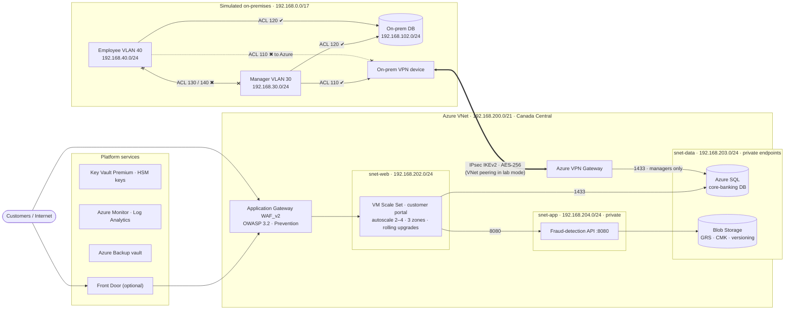

# Hybrid Cloud Migration and CI/CD Automation on Azure

*Secure hybrid architecture for N-Financial Bank: Terraform · GitHub Actions (OIDC) · WAF · private endpoints · automated network-segmentation tests*

[](https://github.com/SANJU-571/hybrid-cloud-migration-cicd-azure/actions/workflows/ci.yml)


A deployable, production-patterned **hybrid cloud for a retail bank**, built entirely as code.
It was built as my Master's capstone, *Secure & Scalable Hybrid Cloud Network for N-Financial Bank*: the bank's on-premises network was first modelled in Cisco Packet Tracer, then migrated to a hybrid design on **Microsoft Azure**, implemented end-to-end with **Terraform**, **GitHub Actions (OIDC)** and **automated security and network tests**.

> One command builds a simulated on-premises data centre, an Azure landing zone, the encrypted link between them, a load-balanced web tier behind a WAF, a private application tier, private-endpoint databases, centralised logging, backups and budgets. Another command removes all of it.

---

## Architecture



More detail: [docs/ARCHITECTURE.md](docs/ARCHITECTURE.md), including the address plan, traffic flows and the NSG rule matrix that replaces the Cisco ACLs.

## What this project demonstrates

| Area | Implementation |
|---|---|
| **Infrastructure as Code** | 9 reusable Terraform modules, remote state in Azure Storage (Entra ID auth, versioned), environment profiles |
| **Hybrid networking** | Route-based Site-to-Site VPN (IKEv2, AES-256/SHA-256, DH14, PFS2048) or VNet peering; private DNS resolved from both sides |
| **Network security** | Tiered subnets, NSGs that enforce the original Cisco ACLs (110/120/130/140), WAF_v2 in Prevention mode, no public IPs on servers, NAT-only egress |
| **High availability** | Zone-redundant VM Scale Set with CPU autoscale, Application Health extension, automatic instance repair, rolling upgrades |
| **Data protection** | Azure SQL and Blob Storage behind private endpoints, HSM-backed customer-managed keys with auto-rotation, blob versioning, lifecycle tiering, GRS |
| **Identity & secrets** | Managed identities, Azure RBAC, Key Vault in RBAC mode with purge protection; SSH keys and DB passwords generated and stored only in Key Vault |
| **Observability & audit** | Log Analytics, subscription Activity Log export, Key Vault/SQL/WAF/Blob audit logs, metric alerts, an alert on any NSG rule change |
| **Resilience** | Azure Backup daily policy (7 daily / 4 weekly / 12 monthly), optional geo-redundant vault with cross-region restore |
| **FinOps** | Cost-profile switches, Log Analytics daily cap, monthly budget with 50/80/100% alerts, one-command teardown |
| **DevSecOps** | GitHub Actions CI (fmt, validate, TFLint, Checkov, ShellCheck), OIDC deploy with no stored secrets, manual approval gate for apply/destroy |
| **Testing** | `validate-deployment.sh` checks the WAF path, load balancing and east-west traffic, then proves each ACL from real VMs using `az vm run-command` |

## Azure services used

| Capability | Azure service | Terraform module |
|---|---|---|
| Network isolation | Virtual Network, subnets, Network Security Groups, NAT Gateway | `network` |
| Hybrid connectivity | VPN Gateway (VpnGw1AZ) + Local Network Gateways, or VNet peering; ExpressRoute-ready | `connectivity` |
| Compute & autoscaling | Linux Virtual Machine Scale Set + Azure Autoscale, Application Health extension | `compute` |
| Load balancing | Application Gateway WAF_v2 / Azure Load Balancer (Standard) | `compute` |
| Web protection | Azure Web Application Firewall policy (OWASP 3.2 + Bot Manager) | `compute` |
| Global edge & CDN | Azure Front Door Standard | `edge` |
| DNS | Azure DNS (public label) + Azure Private DNS zones | `compute`, `data` |
| Relational database | Azure SQL Database (private endpoint, Entra ID admin, auditing) | `data` |
| Object storage | Azure Blob Storage (versioning, lifecycle management, GRS, CMK) | `data` |
| Identity & access | Microsoft Entra ID, managed identities, Azure RBAC | `security` |
| Secrets & keys | Azure Key Vault Premium (secrets, HSM keys, automatic rotation) | `security` |
| DDoS protection | Azure DDoS Network Protection (toggle) | `network` |
| Threat protection | Microsoft Defender for Cloud (toggle) | `security` |
| Monitoring & audit | Azure Monitor, Log Analytics, Activity Log, metric & activity alerts | `monitoring` |
| Backup & DR | Azure Backup (Recovery Services vault, daily policy) | `backup` |
| Cost governance | Microsoft Cost Management budgets | `monitoring` |
| CI/CD | GitHub Actions + Terraform, OIDC to Entra ID, VMSS rolling upgrades | `.github/workflows` |
| On-prem simulation | Separate VNet with VLAN subnets and test VMs (mirrors the Packet Tracer lab) | `onprem` |

## Repository layout

```
.
├── infra/                      # Terraform root module
│   ├── main.tf                 # wires the modules together
│   ├── variables.tf            # feature flags & sizing
│   ├── environments/           # lab | lowcost | full profiles
│   └── modules/
│       ├── network/            # VNet, subnets, NSGs (ACLs), NAT, DDoS
│       ├── onprem/             # simulated data centre + test VMs
│       ├── connectivity/       # IPsec S2S VPN or peering
│       ├── security/           # Key Vault, identities, CMK, Defender
│       ├── compute/            # WAF, VMSS, autoscale, fraud-detection VM
│       ├── data/               # Azure SQL, Blob, private endpoints & DNS
│       ├── monitoring/         # Log Analytics, alerts, Activity Log, budget
│       ├── backup/             # Recovery Services vault & policy
│       └── edge/               # Front Door
├── scripts/                    # bootstrap state, GitHub OIDC setup, validation tests
├── .github/workflows/          # ci.yml (quality gates) · deploy.yml (OIDC plan/apply/destroy)
└── docs/                       # architecture, step-by-step guide, security notes, project deck
```

## Quick start

Full walkthrough, from an empty Azure subscription to a validated deployment: **[docs/DEPLOYMENT_GUIDE.md](docs/DEPLOYMENT_GUIDE.md)**

```bash
az login
export TF_VAR_alert_email="you@example.com"
./scripts/bootstrap-tfstate.sh                     # once: remote state
make init plan apply PROFILE=lab
make validate PROFILE=lab                          # run the end-to-end tests
make destroy PROFILE=lab                           # stop the billing
```

## Cost profiles

| Profile | What runs | Approx. cost* |
|---|---|---|
| `lowcost` | Everything except Application Gateway WAF (Standard LB instead) | ~US$3–4 / day |
| `lab` *(default)* | Full lab design incl. WAF_v2; on-prem linked by peering | ~US$12–15 / day |
| `lab` + `connectivity_mode="vpn"` | Adds two VPN gateways and the IPsec tunnel | +~US$10 / day |
| `full` | Adds Front Door, DDoS Network Protection, Defender for Cloud, GZRS | ~US$3,500+ / month |

\*Rough Canada Central pay-as-you-go estimates. Check the [Azure Pricing Calculator](https://azure.microsoft.com/pricing/calculator/). **Destroy the environment when you are not demoing it.**

## Security notes

Checkov runs on every push. Each check I skipped is listed with a reason in [`.checkov.yaml`](.checkov.yaml), and the production fix for each is in [docs/SECURITY.md](docs/SECURITY.md). Summary: the lab keeps the Key Vault data plane reachable for GitHub-hosted runners, serves HTTP without a public certificate, and uses the Basic SQL tier to control cost.

## Roadmap

- HTTPS listener with a Key Vault-managed certificate and a custom domain
- Hub-and-spoke with Azure Firewall Premium and forced tunnelling
- AKS for the microservices (containerisation) and Azure Functions for event-driven fraud scoring
- Azure Policy initiative (PCI DSS v4 built-in) assigned to the landing zone
- Self-hosted runners in the VNet so Key Vault can go fully private

## Credits

Design, Azure implementation, IaC and CI/CD: **Bhargav Kiran Surapaneni**.

Licensed under the [MIT License](LICENSE).
